# 特别鸣谢 UFI-TOOLS-ZWRT 面板及开发者

**特别鸣谢 UFI-TOOLS-ZWRT 面板及开发者，感谢提供这么好的平台。** 本项目依托其插件运行环境、设备接口与现有功能制作 TopFlow 屏幕界面，也感谢相关开源项目的贡献者。致谢不代表上游对本项目提供支持或背书。

# TopFlow Screen · v0.2.11 最终版

**By：善恶** · [GitHub：shaoxiame](https://github.com/shaoxiame)

**v0.2.11 是本项目最终版，不承诺持续维护。仓库保持开放，不归档，Issues 与 Discussions 等反馈入口保留。** 可以查阅、讨论和反馈，但不承诺答复、修复、功能开发或合并请求处理。需要调整时，请在许可允许的范围内自行修改、自行验证并自行维护。

**源码公开，仅限非商业用途。** 本项目原创部分采用 [PolyForm Noncommercial 1.0.0](LICENSE)，允许按该协议使用、修改和分发，不授予商业用途许可。它不是 OSI 定义的开源许可证。第三方代码继续遵守各自原许可，详见 [授权边界](docs/LICENSING.md) 与 [第三方声明](THIRD_PARTY_NOTICES.md)。

Required Notice: Copyright (c) 2026 shaoxiame (TopFlow Screen contributors).

**2026-10-19 用户实机验收通过：** 用户确认 v0.2.11 实机测试正常，本轮报告的问题全部修复，包括开关机、快速开机首次亮屏及返回插件屏幕；并同意脱敏后发布 GitHub。以下验收记录来自用户实际使用，与开发期间的电脑测试分别记录。

## v0.2.11 开机唤醒与更新设置保留

电脑复现了一个开机点亮链路缺陷：已经进入处理流程的唤醒通知仍留在待处理标记中，显示调用等待期间把它当作新通知取消了自己的事务，继而触发 `DISPLAY_RUNTIME`。本版先消费本批通知，再执行标准唤醒与显示重同步；过程中真正新到的 OFF、唤醒或重同步通知仍能中断当前事务，真正通道故障仍按原有流程恢复原厂。原厂明确 ON 且休眠服务就绪后，插件自动尝试点亮，不依赖再按一次按键。

组件更新保留已确认的开机自启动选择：旧组件完整且已明确开启时，在清理前再次核对；新版连续三次确认运行并恢复壁纸后，只恢复一次自启动，再完整回读确认。关闭、未知、取消或更新失败不会擅自开启，恢复未确认会如实提示，不自动重试。独立安装仍默认关闭，完整卸载仍清理本插件自启动状态。

开发期间仅在电脑验证，没有由开发工具连接、安装或修改设备。2026-10-19，用户随后确认已交付 v0.2.11 实机验收通过，本轮问题全部修复。发布沿用该已验收 TXT、元信息和原生归档，不重新构建。保留 v0.2.10 密码输入与休眠服务恢复，以及 v0.2.9 电源回执修正。

## v0.2.10 密码输入与快速开机显示恢复

“恢复设备登录”的密码编辑器按实际输入的 ASCII 字符数显示圆点：1 个字符显示 1 个圆点，最多显示 12 个，超过时加省略号；下方仍显示完整的字符计数，最多 1024 字符。空输入显示“尚未输入”。不再固定显示 6 个圆点，退格、清空和键盘模式切换时显示同步更新。密码原文仍只保存在受保护内存，不写入页面、日志或成品 TXT；恢复登录后仍需重新确认发送短信。

补上已收到原厂 OFF 和休眠服务不可用通知后的等待恢复路径：保留现有屏幕进程与心跳，暂停依赖该服务的显示操作，服务重新就绪后重新核对显示状态；只有明确的原厂 MC 开机通知才允许自动唤醒。OFF 中重订阅成功不代表开机，也不会因此点亮屏幕。恢复查找和订阅有明确时限，不新增常驻进程，不修改原厂启动脚本，不循环抢回原厂屏幕。

当时用户已确认 v0.2.9 的开关机可以正常执行，同时指出长按开机后仍需再按一次才亮屏，以及快速开机后未自动回到插件屏幕。v0.2.10 针对电脑确认的服务移除与恢复路径修复；该阶段没有由开发工具连接或修改设备，新增恢复行为当时尚待实机确认。后续 v0.2.11 已于 2026-10-19 获得用户实机验收通过的反馈。

## v0.2.9 关机回执异常处理

用户反馈 v0.2.8 关机后静置约 30 秒，长按出现原厂“关机中”，再长按只有背光。当时故障设备无法连接；此前只读连接的是另一台 TopFlow，其状态已排除。照片和描述不足以证明是正常待机，也不能单凭长按无画面认定插件屏蔽了开机键。

电脑故障注入确认：原厂完成通知的错误会被扩大为插件通道故障，导致屏幕程序退出并触发原厂恢复。v0.2.9 将完成通知的已确认、未确认及过期结果独立处理，保持每周期至多一次，不以业务回执未知为由退出关机静默状态；真正断连或协议错误仍按原有安全恢复处理。实体按键仍由原厂接收，插件没有独占按键，不模拟开机，也不凭短按强行解除 OFF。详见[分析与验证边界](docs/analysis/power-completion-029.md)。

**当时用户实测已确认开关机正常，但长按开机后的首次亮屏仍需再按一次，快速开机也曾未回到插件屏幕。** 这些是 v0.2.11 验收前的历史问题；用户已于 2026-10-19 确认本轮问题修复。导入 TXT 后还需更新设备组件，只有替换网页代码不会改变电源处理。

## v0.2.8 电源修复与短信授权

v0.2.6/0.2.7 用户反馈关机、重启未确认，快速关机后仍亮屏。本版补接原厂重启通知和普通电源完成回执，快速关机另补快速完成回执；只有确认熄屏并释放 LCD 锁后才回执，同一周期不重复。电源请求保留发送进度、明确响应不再等待断连，等待预算覆盖后端 8 秒期限；仍不自动重发，也不会把“已发送”标作“已关机”。详见[回归分析](docs/analysis/power-actions-regression-028.md)。本版未代用户执行实机关机或重启。

短信发送继续使用 UFI 的现有接口，插件直接复用本机 UFI 权限，不要求先打开 UFI 网页。原厂设备会话失效时，可在短信编辑页进入“恢复设备登录”，在屏幕内输入原厂管理密码并确认。恢复沿用当前 UFI 面板的 LD / LOGIN 流程；不保存密码、不自动重发，号码和正文保留，需再次确认发送。详见[短信授权分析](docs/analysis/sms-session-authorization-028.md)。

## 这是什么

面向中兴 TopFlow（MU5252）和 UFI-TOOLS-ZWRT 的原生屏幕插件。设备端以 C/C++、litehtml 和 FreeType 绘制 320×480 界面，通过已有 UFI、原厂及本机数据服务接口读写设备功能；UFI 插件管理页负责安装、切换原厂/插件屏幕、更新组件、自启动和卸载。

它是针对已分析固件和运行环境的适配实现，不是所有 TopFlow 固件通用的替换程序，也不保证与原厂全部功能等效。原厂程序、设备字体和固件库不在本仓库分发。

v0.2.3 增加实体电源键长按菜单，可在解锁后选择关机或重启并单独确认。亮屏长按不会先触发唤醒或重新锁定，熄屏时沿用原有唤醒流程；原厂恢复和插件屏幕切换仍由 UFI 管理页处理。

v0.2.8 针对用户反馈的快速关机后仍亮屏，补接原厂 MC 电源事件、持续熄屏门禁及指定事件的完成回执，重新编译屏幕组件。v0.2.7 的 UFI Shell 长度修复、首页透明卡片、Wi-Fi 状态同步、自选锁屏壁纸等功能继续保留。平台接口与商店说明以 [UFI-TOOLS-ZWRT 1.0.0 官方文档](https://tapan.top/UFITOOLS-U60Pro/1.0.0%E6%96%B0%E7%89%88%E6%9C%AC%E6%96%87%E6%A1%A3) 为准，不含旧商店入口、远程版本检查、遥测 SDK 或数据上报。插件保留设备本地组件的版本核对和更新，不另设第三方商店服务。

## 最终版包含什么

| 位置 | 已实现的界面与接口范围 |
| --- | --- |
| 首页 | 三张卡的状态、运营商、实际制式、实时上下行、QCI；普通与聚合显示跟随实际设备状态。 |
| 卡片详情 | 每卡签约上行/下行、内置卡与插拔卡切换、模块启用及相应确认/回读；未插卡不再隐藏卡源选择。 |
| 网络信息 | 信号和驻留信息、载波聚合 CA、聚合网络套餐/流量及网口状态；CA 与多链路聚合分别处理。 |
| 设备控制 | 已核实的主卡连接、APN、制式、频段和小区锁定接口；主/访客 Wi-Fi、WPS及连接设备管理；已有遨游世界引擎模式和 Selector。 |
| 短信与系统 | UFI 短信发送、插件内原厂登录恢复和转发配置、散热常开、供电和休眠、固定/自适应亮度、充电状态。 |
| 交互与锁屏 | 三个主页面、左右滑动、固定顶栏、子页返回、日夜主题；锁屏双曲线和速率过渡；无密码时显示“长按解锁”，设置密码时走原厂验证。 |
| 实体电源键 | 长按约 1.2 秒打开独立电源菜单；解锁后关机/重启须另行确认，锁定时提示先解锁。 |
| UFI 管理页 | 首页内嵌卡片、宿主主题适配、原厂/插件屏幕切换、受信版本组件更新、自启动、锁屏壁纸与完整卸载。 |

数据缺失、过期、卡片未启用或未插卡时显示明确状态或未知值，不借用其他卡的数据。5G-A 只在接口明确报告时显示，不以载波聚合、多卡聚合或测速结果推断。

## 三个主页面怎么用

主页面用左右滑动切换，不设置占空间的底部导航栏；顶栏固定。右上角的日夜图标切换主题，返回按钮只出现在子页面，用于返回上一层。原厂/插件屏幕选择在 UFI 管理页完成，不混入设备屏幕的返回操作。

| 页面 | 首屏内容 | 下一层入口 |
| --- | --- | --- |
| ① 首页 | 普通模式显示主卡实时速率与各卡状态；设备实际启用聚合后，同一页位切换为聚合视图。 | 点击对应卡片进入该卡详情，查看实时上行/下行、QCI、签约上行/下行，以及内置/插拔卡来源。 |
| ② 网络参数 | 主卡信号、驻留参数、载波聚合 CA 与载波明细；下方有线网口和聚合网络状态。 | “频段与基站”进入已支持的制式、频段和小区锁定控制。 |
| ③ 功能 | Wi-Fi、短信、遨游世界和设备设置。 | 设备设置继续进入显示与锁屏、散热与电源、流量管理、连接设备，并查看温度及占用。 |

普通/聚合共用一个首页位置，不会多出第四个主页面。聚合首页由设备报告的聚合状态决定，屏幕本身不提供虚构的聚合开关；状态未知或过期时回到普通视图。无线载波聚合 CA 与多链路聚合网络不是同一功能。

卡片来源选择与“是否插入实体卡”独立：有卡或空卡槽都保留内置/插拔卡选择。卡模块未启用时，先在对应入口明确启用，再选择卡源。成功提示依据本卡原始卡源回读，不能据此推断内置卡套餐已开通或网络已注册。

### 实体电源键与电源菜单

在原厂 MC 仍处于 ON 的状态下，按住设备实体电源键约 **1.2 秒**打开电源菜单。屏幕已亮时直接显示菜单，保留当前页面；普通熄屏时先按原有流程唤醒，再显示菜单。原厂明确 OFF 后不通过插件电源菜单唤醒。这不会替换原厂/插件屏幕，短按的原有行为也不变。

| 当前状态 | 菜单行为 |
| --- | --- |
| 已解锁 | 选择“关机”或“重启”，阅读中断网络连接的提示后再次确认，才提交操作。 |
| 原厂 PIN 锁定或本地防误触锁定 | 菜单可见，但关机和重启不可用，提示先解锁；取消菜单返回原锁屏，不代为解锁。 |
| 接口能力未确认或不支持 | 相应操作不可用；确认时还会重新核对接口能力。 |

打开电源菜单会撤销尚未确认的业务操作，避免把原先的短信、网络或设置确认误用为电源确认。取消菜单回到原页面和滚动位置；进入休眠或重新同步显示状态时关闭菜单，旧的选择不能在下次唤醒后继续提交。

关机和重启使用已有本机数据服务的设备电源接口。每次明确确认只提交一次请求；超时或设备断线时显示结果未确认，不自动重试。“请求已接受”不等于已经完成关机或重启，实际结果需观察设备。

### 快速开机与假关机

快速开机的设置开关与实际关机状态分别处理。仅开启设置不熄屏；收到原厂 MC 关机事件后，插件通过原有 LCD 联动关闭显示，丢弃触摸、手势和电源键的本地界面动作，并撤销尚未确认的操作。事件锁存优先于滞后的磁盘状态，只有明确的 MC 开机通知才能解除；依赖服务可用时，每秒核对实际背光，被其他服务点亮时重新熄屏，不重复延长休眠延时。普通关机和重启在熄屏回读后，每周期至多尝试一次普通完成回执；指定的 quickening 事件另有至多一次快速完成回执。查找失败可能使回执未送达，结果未知时不自动重发；不新增关机参与者、不写原厂电源状态。服务不可用时暂停该协议，未回读确认的熄屏和完成回执不会假报成功。详见 [v0.2.9 完成回执分析](docs/analysis/power-completion-029.md) 与 [v0.2.8 事件接入记录](docs/analysis/quick-boot-events-028.md)。

UFI 首页管理卡片直接采用宿主卡片背景和模糊参数，内层卡片透明，按钮继承宿主配色；确认弹窗使用独立的宿主弹窗底色。电脑验证与证据边界见 [快速开机与透明卡片分析](docs/analysis/quick-boot-glass-026.md)。

### 自选锁屏壁纸

在 UFI 首页的 TopFlow 屏幕卡片中选择 JPG、PNG 或静态 WebP 图片，最大 12 MB。浏览器先居中裁切为 320×480 并显示预览；点击“应用壁纸”并确认后才上传。选择图片或预览本身不会改变设备。

设备只接收固定 307,216 字节的 RGB565 像素文件，原始照片和图片元数据不上传。上传结束后校验归属、类型、长度、文件头及 SHA-256，再原子替换本插件壁纸；旧图保留到校验成功。壁纸在下一次锁屏或唤醒时读取，无后台轮询；原生缓存约 300 KiB，不在设备端运行图片解码器。

锁屏保留上下行速率、制式和运营商信息、图表与“长按解锁”动效，并覆盖深色遮罩保证可读性；自定义背景不会用于业务页面。点击“恢复默认”可删除已识别的壁纸，原厂背景和文件不变。

壁纸通过 UFI 已有命令接口逐块传送，每块最多 24 KiB；不使用通用文件上传接口。每块数据都在插件生命周期锁内核验 SHA-256、随机事务编号、当前开机 UUID 和写入偏移。响应未知时保留原图与事务，不自动重传或提交；可刷新查看进度，再明确选择清理并重新开始。清理或完整卸载后，迟到的旧分块因事务失效而拒绝执行，也不会重建目录。同一图片的新事务使用不同编号；跨开机的旧像素不能提交。未知文件、符号链接或校验异常不会被自动覆盖或删除。

## 画面

**v0.2.8 短信设备登录恢复 · 电脑原生渲染。** 插件内输入原厂管理密码，独立保护内存，完成后返回短信草稿。下图保留 v0.2.8 的合成画面，不是实机登录截图，其中旧密码遮罩样式不代表 v0.2.11。

  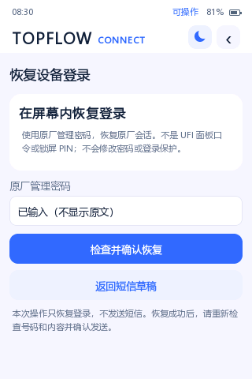
  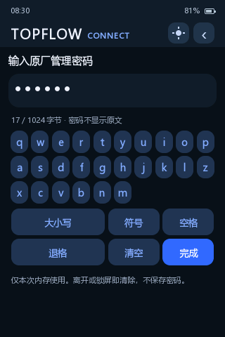

**v0.2.4 锁屏 · 电脑原生渲染。** 下图展示默认深色、聚合浅色、自定义壁纸及长按解锁进度。使用合成状态和测试背景，不是实机截图。

  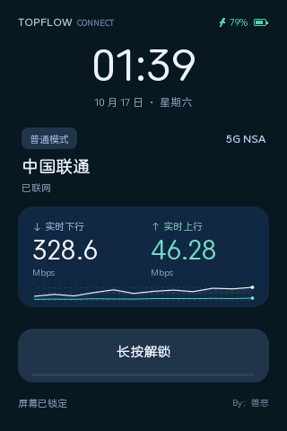
  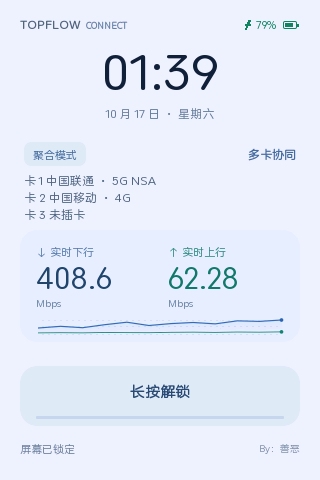

  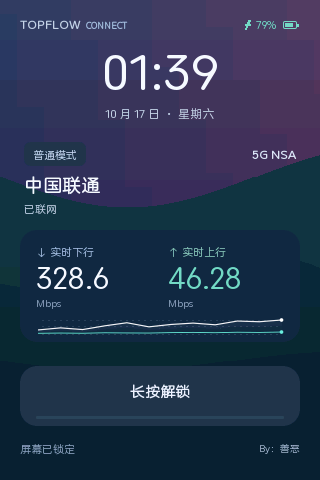
  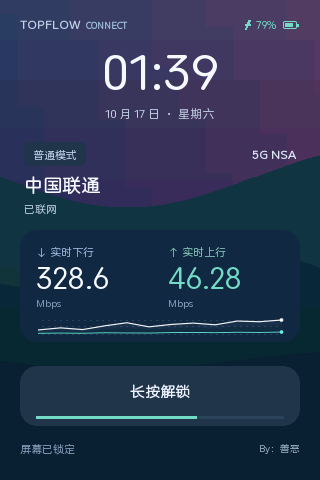

**v0.2.3 电源菜单 · 电脑原生渲染。** 下图使用设备端同一套 litehtml / FreeType 渲染程序和合成状态生成，依次展示浅色菜单、深色菜单、操作确认及锁定保护。它们不是实机照片，不连接设备，也不能证明真实触摸、关机或重启结果。

  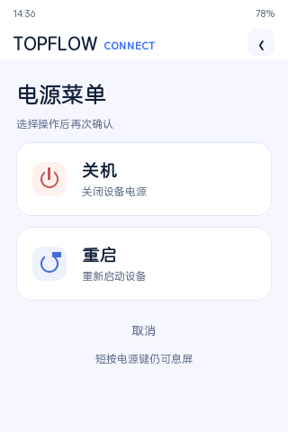
  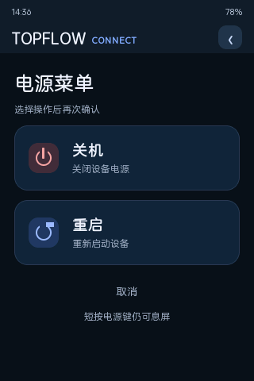

  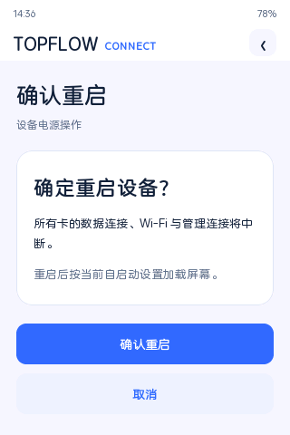
  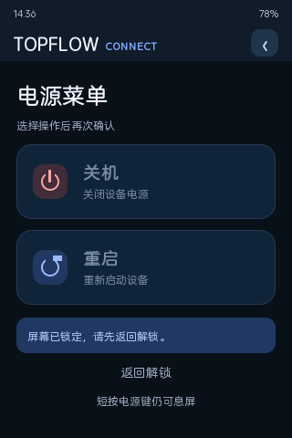

**v0.2.4 UFI 首页卡片 · 电脑浏览器预览。** 管理功能直接内嵌首页，并跟随 UFI 深浅主题。下图为深色桌面布局和浅色 360px 容器布局，使用本地模拟状态，不连接设备；预览适配器不会打入成品。

  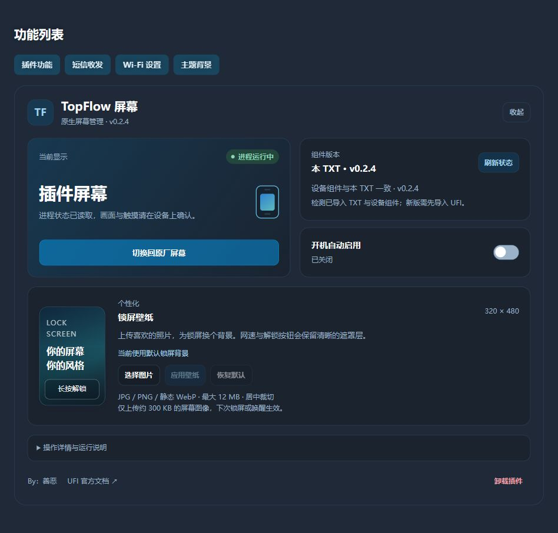
  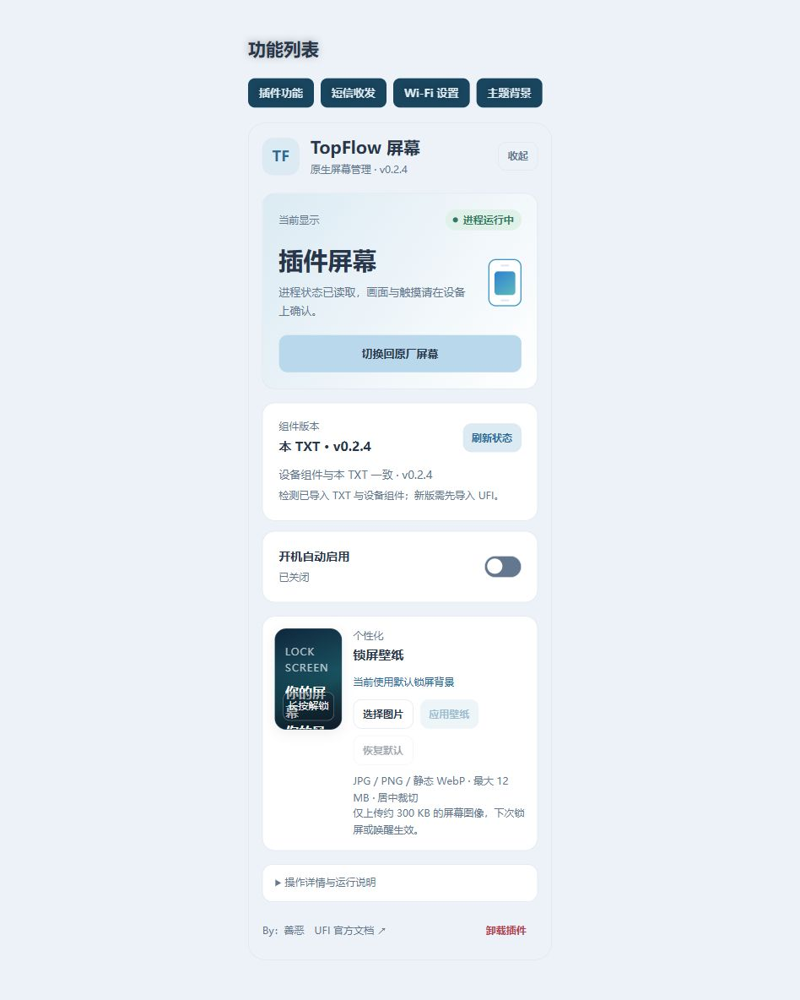
  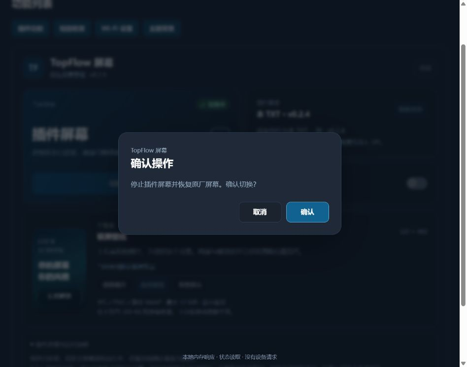

**用户已确认 v0.2.1 完成实机验收。** 以下均为用户拍摄并提供的 TopFlow 实机测试照片，包含不同开发阶段的界面；部分画面与 v0.2.1 的最终样式有差异。v0.2.9 后续另有用户开关机正常的实测反馈；这些历史照片不展示 v0.2.11 的修改效果；v0.2.11 的实机验收依据是用户于 2026-10-19 的明确确认，照片不充作本版测试截图。

  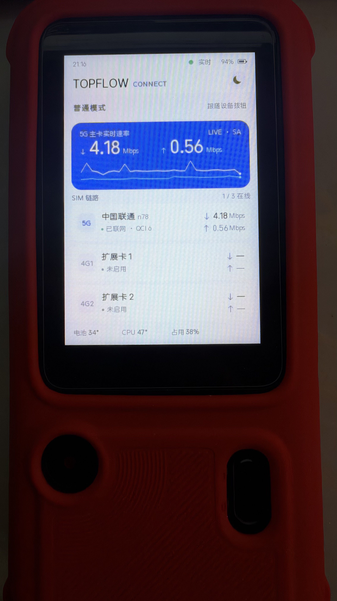
  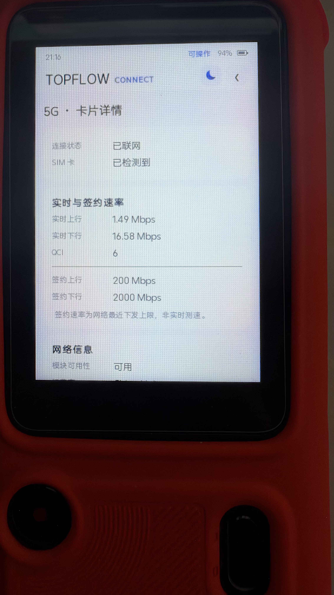
  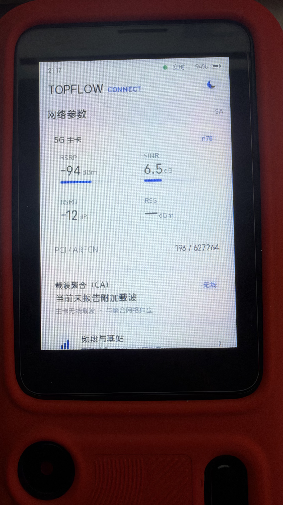

  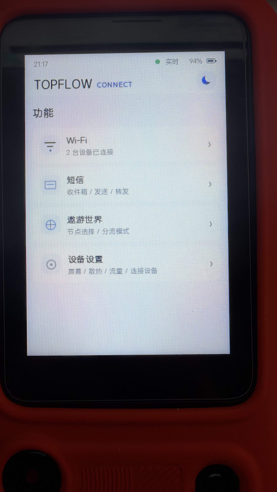
  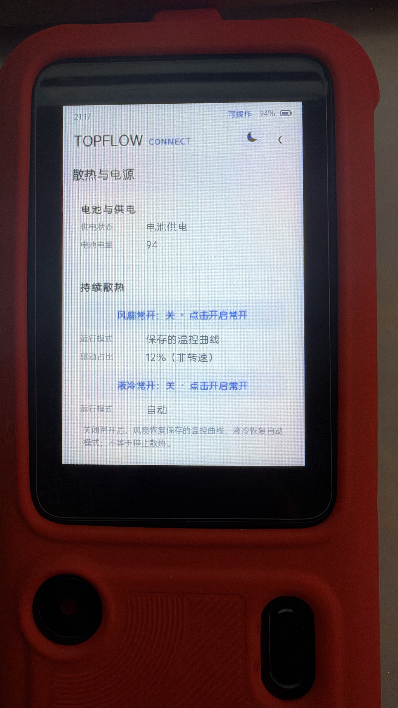
  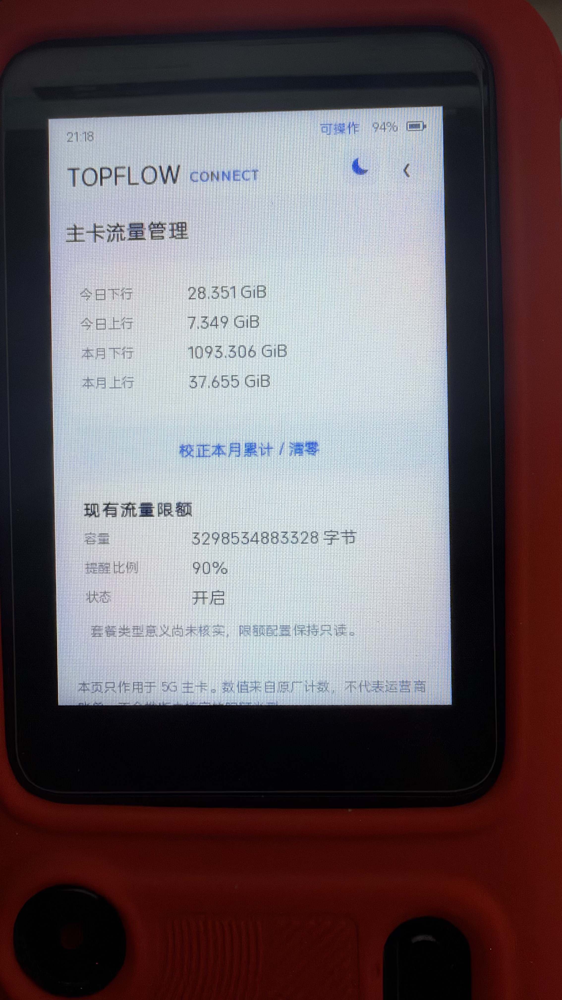

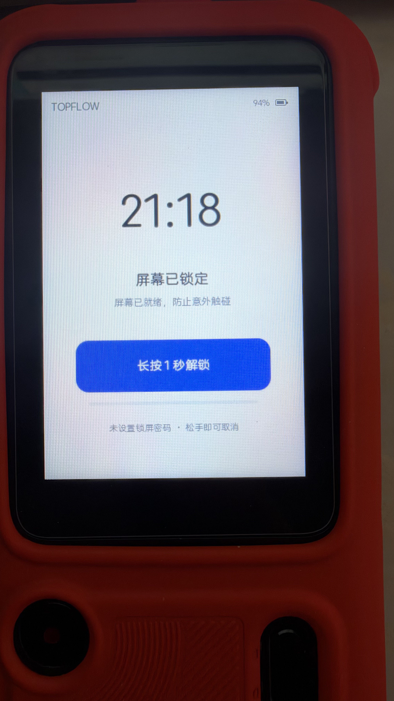

以下为同一原生渲染程序生成的电脑样例画面，使用测试数据；不是当前设备的实时截图。成品插件不包含演示接口。

  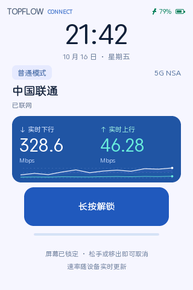
  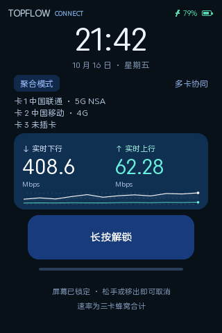

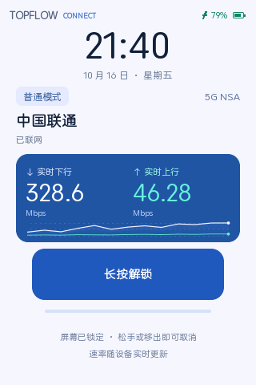

v0.2.6 存在 Shell 命令过长问题，v0.2.7 已修复；但用户实机反馈其快速关机仍亮屏。v0.2.8 后续又收到开机画面异常反馈；v0.2.9 修正电脑已复现的回执失败路径，用户后来确认开关机正常，但长按开机后首次亮屏仍需额外按键；该问题与本轮其他问题已在 v0.2.11 获得用户验收通过的确认。更新时同时更新设备端组件，旧版成品保留用于审计。详见 [Shell 命令长度分析](docs/analysis/ufi-shell-length-027.md) 和 [快速关机修复记录](docs/analysis/quick-boot-events-028.md)。

## 获取和使用

最终原始插件文件放在 [`releases/`](releases/)：[`topflow-screen-0.2.11.txt`](releases/topflow-screen-0.2.11.txt)。通过 UFI 已有插件导入功能上传 TXT，点击“提交”保存并刷新，再在插件管理页操作。它使用完整 `<script>` 包装，不是商店内部安装包，不应手工添加 `KANO_META`。

### 安装前提

- 使用已适配的 TopFlow（MU5252）环境，原厂屏幕能够正常运行；不能仅凭设备名称相同认定所有固件均兼容。安装和切换会校验原厂程序、组件及归属，不匹配时不要绕过检查。
- 设备已经安装并能正常访问 **UFI-TOOLS-ZWRT**，当前面板会话具备插件导入、文件上传和相应设备操作权限。本插件不提供 UFI 安装、设备提权或认证绕过。
- 当前实现依赖已有原厂服务、显示/触摸设备、本机 `zwrt-datad` 数据服务，以及对应固件的 musl、ubus、ubox 库。插件不会替你安装另一套数据服务或替换这些系统库。
- 使用遨游世界功能前，先确保原插件及其引擎已经安装、配置并运行；本屏幕只接入已有控制器，不负责安装引擎、导入订阅或启动另一套代理。
- 通过电脑或手机保留可访问的 UFI 管理页，作为切换和恢复入口。安装期间不要并行运行另一份屏幕安装器或重复提交切换。

### 首次导入与启用

1. 下载本仓库的原始 TXT，在 UFI“插件功能”中的现有导入入口导入，点击“提交”保存，然后刷新面板。商店的一键安装/更新同样先进入编辑区，仍需提交；“仅下载”不代表安装。
2. 打开 TopFlow 屏幕管理页，等待内嵌卡片的组件和屏幕状态读取完成。仅导入 TXT 不代表设备端组件已安装或屏幕已接管。
3. 点击“安装并切换到插件屏幕”，阅读确认内容后执行。管理器上传内嵌原生归档，核对 SHA-256、解包到本插件目录，再交接屏幕。
4. 等待页面显示连续回读确认，随后检查实际画面及触摸。管理器确认的是进程、首帧/心跳等状态；仍需以看到的设备效果为准。
5. 无原厂锁屏密码时，按住“长按解锁”进入；已启用原厂锁屏密码时，按原厂验证流程解锁。网络、短信和设置写入在各自确认后执行。

### 切回原厂与再次启用

在 UFI 管理页点击“切换回原厂屏幕”，等待原厂状态确认。组件保留，之后可以点击“切换到插件屏幕”重新启用，无需重新导入 TXT。切回原厂不会自动关闭已开启的开机自启动；希望重启后仍保留原厂时，请同时关闭该开关。

### 更新已有组件

已有受信旧版时，替换原 TopFlow TXT 记录，点击“提交”并刷新 UFI，再点击管理页中的“更新到 v0.2.11”；不要叠加多份同名功能记录。管理器先恢复并确认原厂稳定，再清理已核验的旧组件、安装并启动新版。更新失败时查看实际状态，不反复覆盖目录。原先已开启且完整回读确认的开机自启动选择，会在新版运行及壁纸恢复成功后恢复并核验；状态未知、取消或失败不自动开启，恢复未确认时请按页面提示处理。

这里替换的是 UFI“插件功能”中的 TopFlow TXT 记录。可以先移除旧 TXT 记录、提交并刷新，再导入新版 TXT、再次提交并刷新；仅处理 TopFlow 记录，保留其他插件。无需先点击旧版卡片中的“卸载插件”，设备端组件由新版管理器核验和迁移。尤其 v0.2.6 状态读取失败时，请直接更新 TXT 入口。

**v0.2.10、v0.2.9、v0.2.8、v0.2.7、v0.2.6、v0.2.5、v0.2.4、v0.2.3、v0.2.2，以及公开版与早期私发 v0.2.1：** v0.2.11 按已核验归档的精确哈希识别，可导入新 TXT、提交刷新后使用本地更新按钮，无需先手动卸载。版本号相同不代表文件相同；只有实际匹配受信归档、文件清单及组件哈希时才允许自动迁移。自行修改、未知或校验不一致的安装不会强行覆盖，需按管理页状态处理。

从 v0.2.4 至 v0.2.9 的已核验归档更新时，管理器先将已校验的锁屏壁纸暂存到当前浏览器内存，清理旧组件后恢复到新版插件目录；不会把备份写到设备其他目录。备份读取或校验失败时停止更新，期间壁纸被另一管理页修改也会停止覆盖。请保持更新页面打开；恢复失败时内存备份保留，可点击“重试恢复壁纸”，关闭或刷新页面会丢失该临时备份。

管理页只核对已导入 TXT 与设备本地组件，不再执行旧商店在线版本检查。获取新的 TXT 由 UFI 内置插件管理或用户手动导入完成，不代表本项目承诺继续发布新版。

### 面板与屏幕状态同步

- 2.4 GHz / 5 GHz 开关读取现有 `wifi.state`，区分配置开关与实际广播；UFI 关闭频段后，屏幕显示“已关闭”。重载显示“正在应用”，尚未广播和状态未知分别提示，不再使用主 SSID 的标志推断射频开关。
- 当前 Wi-Fi 页面约每 3 秒异步读取，其他需要独立接口的当前页约每 5 秒读取；触摸操作、确认和休眠期间暂停，离开页面取消旧请求。已有 datad 实时数据继续用于网络、散热、流量和终端状态。
- SIM 卡源、APN 列表、遨游模式与策略组、访客网络、双频合一、电源模式、WPS/SIM 状态及短信转发概览会更新。短信转发仍需有效 UFI 会话，不绕过认证。不会为刷新触发搜网、配对、发送或修改设置。
- 未编辑的 Wi-Fi / 频段 / 显示配置跟随最新值；正在编辑的草稿保留。Wi-Fi、APN、频段及短信转发提交前重新核对，发生外部冲突时不覆盖。接口不可用时显示未知，不把旧缓存显示为已确认状态。
- 外部亮度、自动亮度和休眠时间可安全同步，不重置空闲计时、不主动亮屏、不解除锁屏；PIN 和周期唤醒策略的安全检查继续保留。

同步有轮询与服务应用延迟，页面提示以接口回读为依据，单次回读不等同于实际执行结果；用户对 v0.2.11 的整体验收另行记录。实现与测试范围见 [v0.2.5 同步分析](docs/analysis/ufi-state-sync-025.md)。

### 开机自启动

组件安装并确认可用后，在 UFI 管理页开启“开机自动启用插件屏幕”，确认显示已开启。此开关默认关闭；启用后通过 UFI 官方插件启动入口，在原厂及本地服务就绪后尝试加载屏幕，不需要浏览器一直打开。

每次 Linux 启动最多尝试一次，按内核 boot ID 去重，等待就绪最多 120 秒；失败后走现有原厂恢复流程，不循环重启。快速开机的假关机通常保留本次 Linux 运行，不会重新触发这一启动任务。v0.2.11 的恢复由仍存活的屏幕进程处理：收到明确 OFF 后可等待休眠服务恢复，明确 ON 后再唤醒；它不是退出后自动重装或反复接管机制。若真正断连、显示故障或其他不支持的时序已经触发原厂恢复，仍需在管理卡片重新启用插件。

关闭开关会取消尚未接管的启动任务，但不切换当前正在显示的屏幕。手动恢复原厂会取消本次 Linux 启动的待执行接管，不在之后自动抢回屏幕。卸载会移除本插件拥有的自启动项，保留共享启动文件中其他插件的内容。

### 完整卸载

1. 在 TopFlow 管理页点击“卸载插件”并确认，保留该页面等待结果，不先删除管理入口。
2. 管理器关闭本插件自启动，停止自有进程，恢复并确认原厂屏幕，再清理本插件组件和临时状态。
3. 自定义壁纸、分块暂存和已识别事务在同一生命周期锁内清理，迟到的壁纸命令无法重建目录。原生组件归档的通用上传仍沿用原有完成核验；其结果未知时停止卸载，不会假报卸净。
4. 面板记录也会按当前插件身份安全删除。出现“实体组件已清除，面板记录清理尚未确认”时，按页面提示核对 UFI 中本插件记录；不要删除其他插件或整份 `custom_head`。
5. 成功后刷新 UFI，移除浏览器内已加载的旧入口。

卸载只清理已确认属于本插件的内容，遇到未知归属、文件变更或原厂恢复失败时停止，不以删除未知文件来冒充完整卸载。仅删除 TXT 记录不能替代设备组件卸载。

### 切换或安装失败时

先点击“刷新状态”查看当前屏幕、组件和失败状态；仍可操作时，优先使用“切换回原厂屏幕”确认恢复。出现“清理未完成安装”只清理已识别的本插件未完成安装；上传状态未确认时不会擅自清理。监管程序在渲染器退出或心跳异常时尝试恢复原厂，但不能把错误提示当成已经恢复成功。以管理页新的回读与实机画面共同判断，不关闭校验、不手工覆盖未知目录。

## 接口来源与系统边界

| 能力 | 实现使用的来源 |
| --- | --- |
| 网络状态、信号、QCI、签约速率与多项控制 | 已有本机 `zwrt-datad` 的状态与控制接口；各卡独立取值，缺失值不跨卡补齐。 |
| 短信发送与转发 | 已有 UFI goform `SEND_SMS`、当前授权会话及 UFI 短信转发配置接口；没有新增短信转发服务。 |
| 内置/插拔卡与部分原厂设置 | 已核实的原厂卡源 setter、ubus 服务及固定配置字段；按目标卡发送并读取对应原始结果。 |
| 显示、亮度、锁屏与休眠 | 原厂已有显示配置、PIN 验证、ubus 和设备接口，与本插件显示生命周期适配；不会初始化或打包原厂闭源 SDK。 |
| 电源键菜单的关机/重启 | 先读取本机 9460 服务的 `/capabilities`，确认后通过 `/control` 提交 `device.poweroff` 或 `device.reboot`；不运行另一套关机脚本。 |
| 遨游世界 | 已运行的 Mihomo 控制器及其既有模式、Selector 接口；复用当前安装，不另建引擎。 |
| 网口状态 | 内核链路/协商速率与已有网络数据；不通过主动外网测速制造流量。 |
| 安装、切换、自启动与卸载 | UFI 已有文件上传和命令接口，以及官方插件启动入口；操作限制在本插件组件及必要显示交接范围。 |

设备端界面使用真实接口，不内置演示数据回退。浏览器预览的合成数据单独放在开发工具中，不进入成品 TXT。控制操作有确认、输入校验和回读；短信不会因超时自动重发，接口响应成功也不等于运营商已完成投递。

原厂程序及系统库保留，屏幕进程交接前后检查归属和状态。失败恢复由本插件监管程序执行；恢复未确认时停止后续清理。原生历史曲线和缓存有界并保存在进程内，熄屏停止锁屏动画，不保存持续增长的速率历史或追加运行日志。需要写入的设备设置仍会改变相应设置，不能把“使用官方接口”理解成完全没有系统状态变化。

## 源码与本地构建

| 路径 | 内容 |
| --- | --- |
| `src/` | UFI 插件管理页、管理页样式、网页界面和设备 API 适配。 |
| `native/` | C/C++ 原生程序、控制与状态逻辑、屏幕交接/监管/自启动脚本及原生测试。 |
| `native/ui/` | 设备端 HTML/CSS 模板，包含首页、网络参数、功能入口和子页面。 |
| `native/upstream/` | 保留原许可证的 u60pro-devui 后端与适配修改。 |
| `native/vendor/` | 必要头文件、字典来源、ABI 声明及第三方许可证。 |
| `tests/` | 电脑上运行的接口、管理页、打包和安全边界测试。 |
| `tools/` | 固定依赖准备、本地预览、测试、门禁和 TXT 打包工具。 |
| `docs/` | 构建、授权、公开验证、图片说明和脱敏分析记录。 |
| `releases/` | 最终原始插件 TXT 与相应交付材料。 |

公开源码包排除了原始设备抓取、原厂资源、私有凭据、编译器缓存与未审阅参考包。

使用固定版本依赖构建，并按 [docs/BUILD.md](docs/BUILD.md) 完成准备、测试及打包。当前版本不需要下载旧商店遥测 SDK。设备字体、共享库和本地构建输入的边界也见构建文档。

查看本地管理页外观可运行 `node tools/manager-preview-server.cjs`，浏览器访问 `http://127.0.0.1:8882`；这只用于电脑上的样式和交互检查，不连接设备。原生屏幕的网页预览仍由 `npm run preview` 提供。

## 分析记录

[`docs/analysis/INDEX.md`](docs/analysis/INDEX.md) 收录 600 份历史分析、接口核实和测试记录，保留原有逻辑目录。其中 479 份为文本或 JSON 脱敏副本，121 份原始敏感捕获或固件代码导出以说明替代。密码、认证信息、短信和订阅内容、设备标识、个人路径等不公开；固件、原厂 WebUI、设备字体、旧归档及参考项目整包也不夹带上传。

这些材料经过有损脱敏，早期失败结论可能已被后续版本修复；它们用于解释开发过程，不能作为当前版本完整实机验收的证明。真实照片与本地渲染图的来源见 [截图说明](docs/screenshots/README.md)。

## 验证范围和已知限制

2026-10-19，用户明确确认 v0.2.11 实机测试正常、本轮报告的问题全部修复，涵盖开关机、快速开机首次亮屏及返回插件屏幕。该结论来自用户实际使用，并非开发工具自行操作设备所得。此前 v0.2.1 的验收照片、v0.2.9 开关机正常及首次亮屏异常的反馈保留为历史记录。用户验收不扩展为任意设备、固件或未测试场景的兼容承诺。

v0.2.11 开发和构建检查只在电脑进行，没有由开发工具连接、上传、安装或修改设备；此前另一台 TopFlow 的 SSH 数据仍不用于判断故障设备。电脑事件和接口测试与用户实机验收分别记录。

[公开构建记录](docs/PUBLIC-BUILD-VERIFICATION.json) 区分用户实机验收与电脑检查：其中构建器的 `hardwareVerified=false` 表示电脑构建没有自动执行设备验收；新增 `userReportedHardwareAcceptance` 单独记录用户于 2026-10-19 对 v0.2.11 的验收通过，不回改历史电脑测试标记。不同版本及不同构建的哈希分别核验，不能凭版本号代替完整性检查。

历史 v0.2.1 公开仓库曾通过 [GitHub Actions 干净克隆检查](https://github.com/shaoxiame/topflow-screen/actions/runs/38913466039)：191 项测试，188 项通过、3 项跳过、0 项失败。当时跳过项包括未分发的历史设备输入和未下载的旧商店 SDK；这组旧统计不作为 v0.2.11 的测试结果。当前公开测试入口已移除旧 SDK 测试并增加远程接入移除检查，跳过项不计为通过。

原交付记录包含 38 组原生测试、85 项界面/数据测试、21 项打包/导入测试、32 项插件中心检查；锁屏覆盖 20 个布局、4464 个命中点和 8 个实际动画帧。源码/载荷哈希及敏感信息扫描另有检查。上述是对应交付版本的本地结果，不能证明真实帧率、短信投递、切卡后注册、开机接管、休眠唤醒或卸载的实机效果；公开整理后的检查按随仓库的构建说明复现。

以下原厂项目仍未完整移植：全部外卡独立拨号/频段/套餐、完整流量提醒、RJ45/WAN/UPnP/DMZ 配置、充值认证二维码、固件升级、多语言、NFC、充电宝/小电流、全部通知和证书、完整短信历史分页/批删、SIM PIN 修改/启停/保存、网络锁解锁。小区采集不启用；纯 IPv6 聚合 TCP 的补充观测未实现。无相应证据时显示未知，不声称功能已完成。

屏幕切换必然涉及显示进程与显示资源交接，设备控制会通过已有接口执行对应设置。本项目不承诺“绝对不影响系统”。仓库和反馈入口保留，但最终版停止持续维护，不承诺后续修复、兼容适配或技术支持。

## 官方插件入口、元信息与数据说明

入口及格式以 [UFI-TOOLS-ZWRT 1.0.0 官方文档](https://tapan.top/UFITOOLS-U60Pro/1.0.0%E6%96%B0%E7%89%88%E6%9C%AC%E6%96%87%E6%A1%A3) 为准：设备内的“插件功能 → 插件商店”负责列表与安装；“自定义源”留空或选择“恢复内置源”使用宿主的官方内置商店。文档并未要求本插件直连某个新的中央域名，也不要求携带旧平台遥测 SDK。

v0.2.2 已移除旧商店链接、旧平台在线版本检查、SDK 加载和定时上报；本插件不再为旧平台采集或上报宿主 UUID、型号、固件或 Wi-Fi 终端数量。必要设备数据仍在本机用于屏幕显示与控制，不等于停止设备接口读取。打开官方文档是用户主动访问网页，不是后台商店连接。

构建同时生成 `topflow-screen-0.2.11.txt.meta.json`，内容为官方自定义源规范的元信息对象，包含 `version`、名称、作者及 TopFlow 型号限制。该旁文件供源维护者制作清单，不要当作插件 TXT 导入，也不是手写的商店安装标记。TXT 内版本注释用于阅读，本地组件版本用于管理器核对；商店更新比较使用源条目的 `meta.version` 及其规定的完整性字段。

本仓库提供原始 TXT 和元信息，不代表已被官方商店收录，也没有替用户更改设备的插件源配置。自行维护静态源时应按官方规范填写 `download_url`、`res.code:200`、条目大小和 SHA-256，并用最终分发字节生成清单；不能将 GitHub 文件预览页或文档页直接填作商店 API。

## 致谢与授权

除 UFI-TOOLS-ZWRT 外，本项目使用或参考了 [u60pro-devui](https://github.com/33333s/u60pro-devui)、[litehtml](https://github.com/litehtml/litehtml)、[FreeType](https://freetype.org/)、[pinyin-data](https://github.com/mozillazg/pinyin-data)、OpenWrt 相关组件，以及 [topflow-toolkit](https://github.com/imshuhao/topflow-toolkit) 的公开适配思路。完整来源、版本和许可证见 [THIRD_PARTY_NOTICES.md](THIRD_PARTY_NOTICES.md)。

本项目由 **shaoxiame（TopFlow Screen contributors）**整理公开，与中兴、运营商及上述上游项目不存在官方隶属关系。非商业用途限制只适用于本项目有权授权的内容；不能改变第三方原许可证，也不能撤销已经合法授出的许可。
